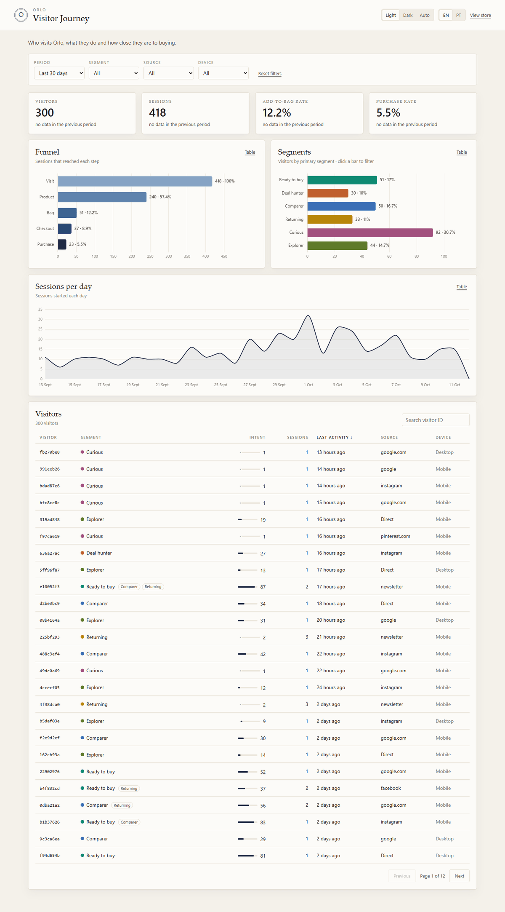

# VisitorJourney
Fictional premium menswear store with first-party event tracking, a visitor journey dashboard and rule-based segmentation (Curious, Comparer, Ready to buy, Returning, Deal hunter). Each visitor gets a 0–100 intent score and a plain-language explanation. Node.js, Express, MongoDB. GDPR-friendly, synthetic data only.

> A fictional premium menswear store with first-party event tracking, a visitor journey dashboard and rule-based intent scoring.



**Live demo:** [link] · **Store:** [link] · **Dashboard:** [link]

## Why this project

Analytics tools show where visitors go. They rarely answer the question growth teams actually care about: *what kind of customer is this?* This project tracks each visitor's journey on a store and classifies them into a segment with an intent score and a plain-language explanation of why.

## What it does

- Fictional premium menswear store (home, collection, product, cart, simulated checkout)
- Privacy-friendly tracker that sends events to a Node.js API after consent
- Dashboard with KPIs, funnel, segment distribution and a **per-visitor timeline**
- Rule-based segmentation and a 0–100 intent score, fully explainable and unit-tested
- Seed script that generates ~300 synthetic visitors over 30 days (deterministic)

## Segments

| Segment | How it is identified |
|---|---|
| Curious | [rule] |
| Comparer | [rule] |
| Ready to buy | [rule] |
| Returning | [rule] |
| Deal hunter | [rule] |

The intent score combines event weights and recency. Weights and thresholds live in `[path/to/config]` so they are easy to tune.

## Tech stack

HTML, CSS, JavaScript · Node.js, Express · MongoDB · Chart.js · Jest

## Architecture

```
Store (HTML/CSS/JS) → tracker.js → POST /api/events → MongoDB
                                                         ↓
                          Dashboard ← segmentation + scoring
```

## Event schema

| Field | Description |
|---|---|
| `visitorId` | Anonymous ID (localStorage) |
| `sessionId` | Session identifier |
| `type` | `page_view`, `view_product`, `add_to_cart`, ... |
| `timestamp` | ISO date |
| `page`, `properties` | Context of the event |
| `utm_*`, `referrer`, `device` | Acquisition and device data |

## Privacy (GDPR)

- Tracking starts only after the visitor accepts the consent banner
- Anonymous visitor ID only; no personal data and no IP addresses stored
- All data in this repository is synthetic

## Run locally

```bash
git clone [repo-url]
cd [repo-name]
cp .env.example .env     # add your MongoDB URI
npm install
npm run seed             # generate synthetic data
npm run dev
```

Store: `http://localhost:[port]` · Dashboard: `http://localhost:[port]/dashboard`

Tests: `npm test`

## Roadmap

- [ ] [next improvement]
- [ ] [next improvement]

## Disclaimer

This is a personal portfolio project. The brand, products and data are fictional and not affiliated with any real company.

## Author

**Cristóvão Monteiro** · [LinkedIn](https://www.linkedin.com/in/cris-tonel-monteiro/)
