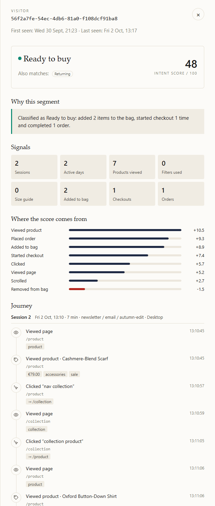
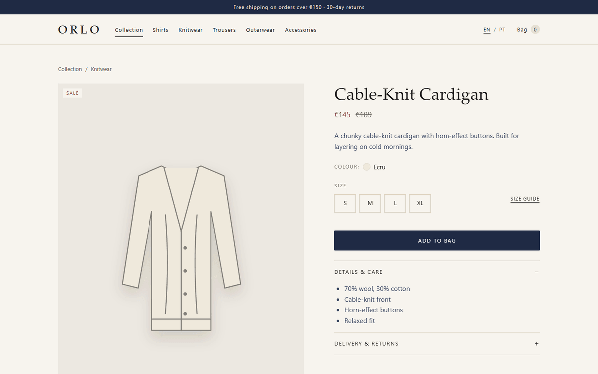
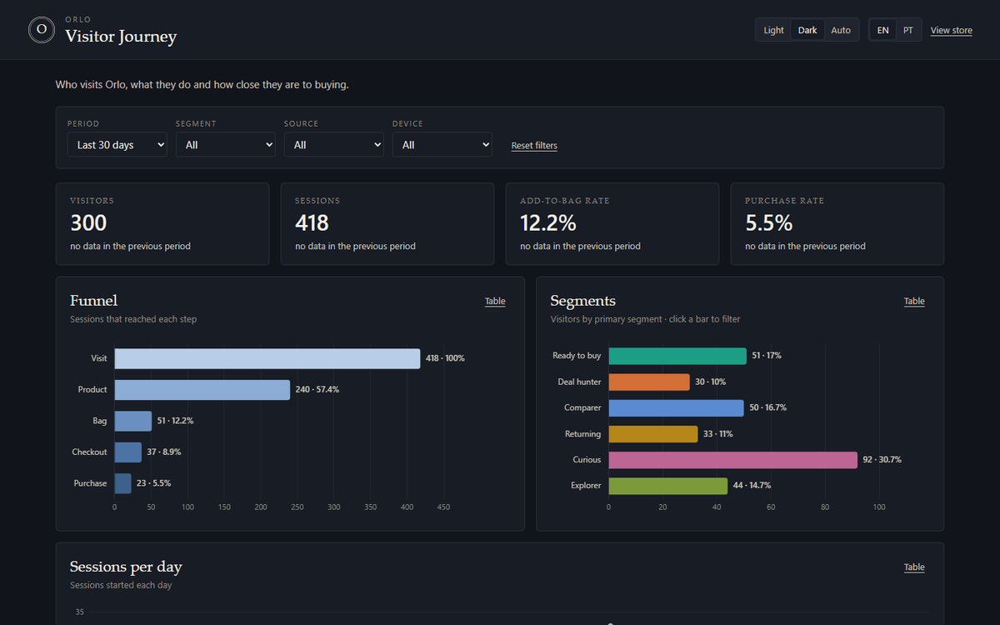
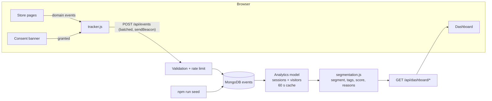

# VisitorJourney

Fictional premium menswear store with first-party event tracking, a visitor journey dashboard and rule-based segmentation (Curious, Comparer, Ready to buy, Returning, Deal hunter). Each visitor gets a 0–100 intent score and a plain-language explanation. Node.js, Express, MongoDB. GDPR-friendly, synthetic data only.

> A fictional premium menswear store with first-party event tracking, a visitor journey dashboard and rule-based intent scoring.


**Live demo:** _added after the first deploy_ · **Store:** `/` · **Dashboard:** `/dashboard`

## Why this project

Analytics tools show where visitors go. They rarely answer the question growth teams actually care about: _what kind of customer is this?_ This project tracks each visitor's journey on a store and classifies them into a segment with an intent score and a plain-language explanation of why.

The goal is the full loop a growth engineer owns: instrument a product with consent, store clean events, turn raw behaviour into decisions (segments, scores, funnel) and make every number explainable to non-engineers.

## What it does

- Fictional premium menswear store (home, collection, product, cart, simulated checkout), bilingual EN/PT
- Privacy-friendly tracker that sends events to a Node.js API **only after consent**
- Dashboard with KPIs, funnel, segment distribution, sessions per day and a **per-visitor timeline**
- Rule-based segmentation and a 0–100 intent score, fully explainable and unit-tested
- Seed script that generates ~300 synthetic visitors over 30 days (deterministic)


## Screenshots

| Visitor journey                                                    | Store                                                                                                                |
| ------------------------------------------------------------------ | -------------------------------------------------------------------------------------------------------------------- |
|  |    |

| Dark mode                                          | Mobile                                            |
| -------------------------------------------------- | ------------------------------------------------- |
|  |  |

## Segments

Every visitor is classified on their **full history**. If several rules match, the first one in priority order becomes the **primary segment** and the rest become **tags** (e.g. _Ready to buy_, also _Returning_).

| Priority | Segment      | How it is identified (default thresholds)                                                                                                                                                                          |
| -------- | ------------ | ------------------------------------------------------------------------------------------------------------------------------------------------------------------------------------------------------------------ |
| 1        | Ready to buy | ≥ 1 `add_to_cart` **or** ≥ 1 `checkout_start`                                                                                                                                                                      |
| 2        | Deal hunter  | Arrived through a promotional/newsletter link (`utm_medium` email/newsletter, `utm_source` newsletter, or a campaign containing _sale_, _promo_, _discount_…) **and** ≥ 60% of the products viewed were discounted |
| 3        | Comparer     | ≥ 3 distinct products **and** at least 2 of: used filters, opened the size guide, went back to a product already seen                                                                                              |
| 4        | Returning    | Active on ≥ 2 different calendar days (Europe/Lisbon)                                                                                                                                                              |
| 5        | Curious      | 1 session, 1 page, < 30 s, no interaction                                                                                                                                                                          |
| –        | Explorer     | Fallback: browsed without a clear buying or comparison pattern                                                                                                                                                     |

Each classification comes with the reasons that triggered it, rendered as a sentence in English or Portuguese:

> _Classified as Comparer: viewed 6 products, used filters 1 time and opened the size guide 2 times._

### Intent score (0–100)

`score = Σ weight(event) × 0.5^(age in days / 7)`, capped per event type, clamped to 0–100.

| Event                     | Weight | Cap    |
| ------------------------- | ------ | ------ |
| `purchase`                | 25     | –      |
| `checkout_start`          | 20     | –      |
| `add_to_cart`             | 12     | –      |
| `newsletter_signup`       | 6      | 6      |
| `view_size_guide`         | 5      | 10     |
| `view_product`            | 3      | 24     |
| `apply_filter`            | 2      | 8      |
| `page_view` / `click_cta` | 1      | 10 / 8 |
| `scroll_depth`            | 0.5    | 5      |
| `remove_from_cart`        | −4     | –      |

Recency halves an event's value every 7 days; caps stop passive browsing from looking like buying intent. The dashboard shows the per-event **breakdown** behind every score.

All weights, thresholds, the priority order and the promo keywords live in one commented file: [`server/segmentation/segmentation.config.js`](server/segmentation/segmentation.config.js). The logic is in [`server/segmentation/segmentation.js`](server/segmentation/segmentation.js) (pure functions, no database access).

## Tech stack

HTML, CSS, JavaScript (no framework) · Node.js, Express · MongoDB (Mongoose) · Chart.js · Jest, Supertest · ESLint, Prettier · GitHub Actions · Render + MongoDB Atlas

## Architecture



- **One service:** Express serves the store, the API and the dashboard (same origin, no CORS).
- **Decoupled tracking:** pages emit domain events (`product:view`, `cart:add`, `purchase`…); `tracker.js` maps them to the event schema, so tracking is never wired into page code.
- **Analytics on read:** the dashboard rebuilds sessions and segments from events (cached 60 s), so changing the config re-segments every visitor instantly. At larger scale this would move to a materialised `visitors` collection updated on ingest.

```
public/            store, dashboard, tracker (vanilla JS modules)
server/
  events/          event contract + strict validator
  models/          Mongoose model and indexes
  routes/          /api/events, /api/dashboard, /api/products
  segmentation/    rules, score, explanations + config
  dashboard/       sessions, funnel, KPIs, visitor list/detail
scripts/           seed, dev:memory, image pipeline
tests/             Jest unit + API tests
data/              product catalogue, photo manifest
```

## Event schema

`POST /api/events` with `{ "events": [ ...1–20 events ] }` → `202 { accepted, duplicates }`.

| Field                                      | Description                                                           |
| ------------------------------------------ | --------------------------------------------------------------------- |
| `eventId`                                  | UUID created in the browser; unique index makes retries idempotent    |
| `visitorId`                                | Anonymous random UUID (localStorage), created only after consent      |
| `sessionId`                                | UUID; a new session after 30 min of inactivity or a new UTM campaign  |
| `type`                                     | One of the 11 types below                                             |
| `timestamp`                                | When it happened (browser clock); `receivedAt` is added by the server |
| `page`                                     | Path only, no query string                                            |
| `referrer`                                 | External domain only (e.g. `google.com`), `null` for direct/internal  |
| `utm_source`, `utm_medium`, `utm_campaign` | Lower-cased, attached to every event of the session                   |
| `device`                                   | `mobile` or `desktop`                                                 |
| `properties`                               | Validated per type (below)                                            |

| `type`              | `properties`                                              |
| ------------------- | --------------------------------------------------------- |
| `page_view`         | `pageType`                                                |
| `scroll_depth`      | `depth`: 25, 50, 75 or 100                                |
| `click_cta`         | `cta`, optional `href`                                    |
| `view_product`      | `productId`, `category`, `price`, `onSale`                |
| `apply_filter`      | `filter` (category, price, sale, sort, clear), `value`    |
| `view_size_guide`   | `productId`, `category`                                   |
| `add_to_cart`       | `productId`, `category`, `price`, `size`, `qty`, `onSale` |
| `remove_from_cart`  | `productId`, `category`, `price`, `size`, `qty`           |
| `checkout_start`    | `itemCount`, `value`                                      |
| `purchase`          | `orderRef`, `itemCount`, `value`, `shipping`, `delivery`  |
| `newsletter_signup` | `source` (never the email address)                        |

Validation is strict: unknown fields are rejected, products must exist in the catalogue, timestamps must be recent. Indexes: `eventId` (unique), `{visitorId, timestamp}`, `{timestamp}`, `{type, timestamp}` and a TTL index on `receivedAt` (13 months). The API is rate-limited (60 requests/min per client).

Read-only dashboard API: `GET /api/dashboard/overview`, `/api/dashboard/visitors` and `/api/dashboard/visitors/:id`, all accepting `from`, `to`, `segment`, `source` and `device`.

## Privacy (GDPR)

- Tracking starts **only after** the visitor accepts the consent banner; before that no ID is created and no request is sent
- Accept and Decline have equal weight (no dark patterns); "Privacy settings" in the footer reopens the choice at any time
- Withdrawing consent stops tracking immediately and deletes the anonymous IDs from the browser
- Anonymous random visitor ID only; **no personal data and no IP addresses stored** (the IP is used in memory for rate limiting, never written to the database or logs)
- Unknown fields are rejected by the API, so personal data cannot be stored by mistake
- Newsletter and appointment forms are simulations: what is typed never leaves the browser
- No third-party scripts, cookies or fonts; Chart.js and all images are self-hosted
- Storage limitation: raw events expire automatically after 13 months (TTL index)
- Suggested hosting in the EU (Render Frankfurt + Atlas EU region)
- A [privacy notice](public/privacy.html) explains all of the above to visitors (EN/PT)
- All data in this repository is synthetic

## Run locally

Requirements: Node.js 20+.

**Quickest (no database to install):**

```bash
git clone https://github.com/CristovaoMonteiro/VisitorJourney.git
cd VisitorJourney
npm install
npm run dev:memory       # in-memory MongoDB, seeded with the demo dataset
```

**With your own MongoDB (local or Atlas):**

```bash
cp .env.example .env     # set MONGODB_URI
npm run seed             # generate synthetic data
npm run dev
```

Store: `http://localhost:3000` · Dashboard: `http://localhost:3000/dashboard`

| Script                            | What it does                                                               |
| --------------------------------- | -------------------------------------------------------------------------- |
| `npm run dev`                     | Server with auto-reload (needs `MONGODB_URI`)                              |
| `npm run dev:memory`              | Server + throwaway in-memory MongoDB, seeded (`-- --no-seed` for empty)    |
| `npm run seed`                    | Seeds ~300 visitors; replaces previous seed data only, keeps real visitors |
| `npm test`                        | 68 Jest tests (rules, score, validation, API, analytics, seed)             |
| `npm run lint` / `npm run format` | ESLint / Prettier                                                          |
| `npm run images`                  | Rebuilds AVIF/WebP photo variants and `CREDITS.md`                         |

### Seed data

`scripts/seed.js` simulates six behavioural personas (curious, explorer, comparer, ready to buy, deal hunter, returning) with realistic traffic sources, UTMs, devices, peak hours, weekends and newsletter send days. Segments are **not** forced: they are computed by the same rules as real visitors, and the seed prints a persona → segment matrix as a sanity check of the rules.

- Deterministic: a seeded PRNG (`--seed`, default `20261011`); with `--anchor YYYY-MM-DD` the output is byte-identical
- Dates are relative to today, so the dashboard's "last 30 days" is always populated
- Options: `--visitors 500`, `--reset` (wipes **all** events)

## Deploy to Render

The repo includes a [Render Blueprint](render.yaml): one free Node web service in Frankfurt.

1. **MongoDB Atlas.** Create a free **M0** cluster in an EU region. In _Database Access_ create a user with a strong password. In _Network Access_ allow `0.0.0.0/0` (Render's free tier has no fixed outbound IP; the password protects access). In _Connect → Drivers_ copy the connection string and add the database name: `mongodb+srv://<user>:<password>@<cluster>/visitor-journey`.
2. **Seed the production database** from your machine: put that URI in `.env` as `MONGODB_URI` and run `npm run seed`.
3. **Render.** _New → Blueprint_, connect this GitHub repository and apply `render.yaml`. When asked, paste `MONGODB_URI`; leave `DASHBOARD_PASSWORD` empty for a public dashboard. Render builds with `npm ci --omit=dev` and checks `/api/health`.
4. **Open** `https://<your-service>.onrender.com` and `/dashboard`, then add the URL to _Live demo_ at the top of this README.
5. **Keep the demo fresh (optional).** In GitHub → _Settings → Secrets and variables → Actions_, add a `MONGODB_URI` secret. The [Refresh demo data](.github/workflows/reseed-demo.yml) workflow re-runs the seed every Monday so "last 30 days" never goes empty; real visitors are kept.

Notes: on the free plan the service sleeps after 15 minutes without traffic, so the first request can take ~30–50 s. Every push to `main` redeploys automatically and runs [CI](.github/workflows/ci.yml) (lint, formatting, tests).

## Design notes

- Brand name lives in one file: [`public/js/config.js`](public/js/config.js) (store, dashboard, monogram and order references follow it)
- Editorial photos are free-licence Unsplash images with one shared CSS colour grade, served as AVIF/WebP with lazy loading and alt text; credits in [CREDITS.md](CREDITS.md). Products are original SVG illustrations
- Dashboard colours (segments and funnel ramp) were validated for colour-vision deficiency and contrast in light and dark mode; every chart also has a table view

## Roadmap

- [ ] Materialised `visitors` collection updated on ingest, for scale beyond ~100k events
- [ ] Retention cohorts (week of first visit × returning rate)
- [ ] Segment export / webhook to an email tool (e.g. trigger a size-guide email for Comparers)
- [ ] A/B test of score weights against actual purchases (calibration curve)

## Disclaimer

This is a personal portfolio project. The brand, products and data are fictional and not affiliated with any real company.

## Author

**Cristóvão Monteiro** · [LinkedIn](https://www.linkedin.com/in/cris-tonel-monteiro/)
